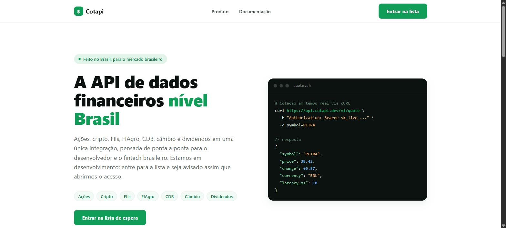

# Cotapi

Landing page de validação de ideia de negócio para o **Cotapi**, uma possível API REST de dados financeiros feita para o mercado brasileiro: ações, cripto, FIIs, FIAgro, CDB e dividendos em tempo real.

## Sobre este projeto

Este repositório **não é o produto** — é um teste de demanda (*fake door / smoke test*) antes de investir tempo construindo a API de verdade.

A ideia: publicar uma landing page descrevendo a proposta de valor do Cotapi, coletar e-mails de interessados numa lista de espera e usar o volume (e a qualidade) das inscrições como sinal de que vale a pena construir o produto. Por isso:

- Não existe backend, autenticação ou banco de dados neste projeto — só a página estática.
- O exemplo de request/resposta da API (seção abaixo) é **ilustrativo**, usado para comunicar a proposta de valor, não uma API real.
- A métrica de sucesso da validação é simples: quantas pessoas entraram na lista de espera, coletado via [LaunchList](https://getlaunchlist.com).

## Preview

### Hero




## Stack

- [Next.js](https://nextjs.org/) 13 (Pages Router)
- React 18 + TypeScript
- CSS Modules (sem dependências extras de estilo)

## Rodando localmente

```bash
npm install
npm run dev
```

A aplicação sobe em [http://localhost:3000](http://localhost:3000).

## Lista de espera

O formulário "Entrar na lista" usa o widget oficial do [LaunchList](https://getlaunchlist.com) (`pages/index.tsx`, componente `WaitlistWidget`), carregado via `https://getlaunchlist.com/js/widget.js` e identificado pelo `data-key-id` da waitlist.

Para trocar de waitlist, crie uma em [getlaunchlist.com](https://getlaunchlist.com), copie o *form key* em **Integration** e atualize a constante `LAUNCHLIST_KEY` no topo de `pages/index.tsx`.

## Exemplo de requisição à API

A landing page ilustra o uso da API com o endpoint de cotação em tempo real:

```bash
curl https://api.cotapi.dev/v1/quote \
  -H "Authorization: Bearer sk_live_..." \
  -d symbol=PETR4
```

**Resposta:**

```json
{
  "symbol": "PETR4",
  "price": 38.42,
  "change": 0.87,
  "currency": "BRL",
  "latency_ms": 18
}
```

> Nota: o endpoint acima é ilustrativo (usado apenas como exemplo na landing page); a implementação da API ainda não está disponível neste repositório.

## Estrutura do projeto

```
pages/
  _app.tsx      # entrada da aplicação, carrega o CSS global
  index.tsx     # landing page
styles/
  globals.css       # reset e variáveis globais (tema verde/branco)
  Home.module.css   # estilos da landing page
```
